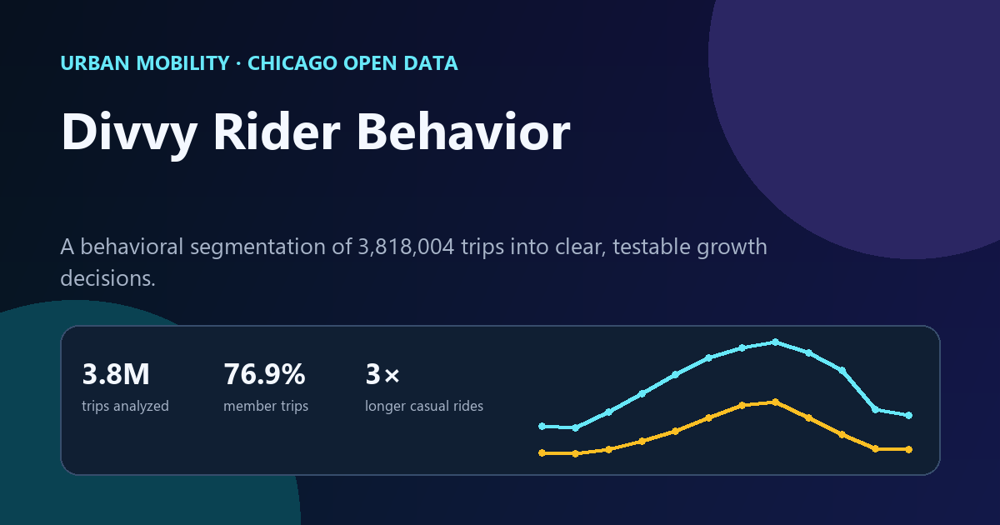

# Divvy Rider Behavior: From Trips to Growth Decisions

[](https://jhon1217.github.io/jhu-data-science-projects/projects/google-data-analytics/divvy/)
[](https://www.python.org/)
[](LICENSE)



## Executive summary

This case study compares **3,818,004 Divvy trips** to identify how members and casual customers differ across season, weekday, hour, trip duration, and origin station.

Members account for **76.9% of trips** and show strong weekday commute peaks. Casual customers account for **23.1%**, ride about **3× longer on average**, and concentrate more heavily on weekends, warm months, and leisure destinations.

## Business question

How can observed rider behavior inform a practical strategy for converting casual customers into members?

## Data

- **Source:** [Divvy Trips, City of Chicago Data Portal](https://data.cityofchicago.org/Transportation/Divvy-Trips/fg6s-gzvg)
- **Period:** January 1 through December 31, 2019
- **Population:** all trips in the public table during the period
- **Segments:** `Subscriber` (member) and `Customer` (casual rider)

The analysis retrieves aggregates directly through the City of Chicago API. It does not publish trip-level records.

## Method

1. Define the annual analysis period and rider segments.
2. Query monthly, weekday, hourly, duration, and station aggregates.
3. Exclude trips below one minute or above 24 hours only from average-duration calculations.
4. Compare segment share and temporal behavior.
5. Translate observed patterns into testable growth recommendations.

## Key findings

| Finding | Evidence |
|---|---:|
| Member share | 76.9% of trips |
| Casual share | 23.1% of trips |
| Casual ride duration | About 3× member duration |
| Casual volume peak | August |
| Member hourly peak | 5 PM |
| Leading casual origin | Streeter Dr & Grand Ave |

## Recommendations

- **Convert during the warm-season peak:** place short membership trials from May through September.
- **Use place-based messaging:** show a simple savings estimate at high-volume casual origin stations.
- **Bridge leisure to routine:** offer a weekend pass whose value can be credited toward membership.
- **Measure incrementally:** test each offer with conversion, retained rides, and incremental revenue as outcomes.

## Repository structure

```text
.
├── assets/preview.png
├── data/results.json
├── src/analysis.py
├── src/validate_results.py
└── README.md
```

## Reproduce the analysis

The pipeline uses only the Python standard library:

```bash
python src/analysis.py
python src/validate_results.py
```

The first command queries the public API and writes `data/results.json`. The validation step checks segment totals, temporal aggregates, and source metadata.

## Limitations

- Trip records show behavior, not customer motivation.
- Weather, events, service changes, and station availability are not modeled.
- Recommendations should be tested experimentally before a large rollout.
- The analysis uses 2019 as a complete, internally consistent baseline and does not claim to describe current demand.

## Interactive result

**[Open the live dashboard](https://jhon1217.github.io/jhu-data-science-projects/projects/google-data-analytics/divvy/)** to compare rider segments by month, weekday, hour, duration, and station.

## Author

**Jhon Deiner Diaz** · [Data portfolio](https://jhon1217.github.io/jhu-data-science-projects/) · [GitHub](https://github.com/jhon1217)
